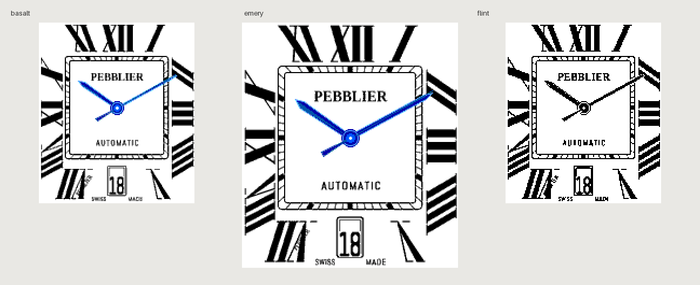

# Pebblier

A native PebbleOS analog watchface inspired by the supplied luxury dial: oversized radial Roman numerals, a square railway minute track, blue sword hands, and a live framed date. Runs entirely on the watch, with no networking, phone JavaScript, or account requirement.



## Devices

| Platform | Watches | Display | Treatment |
| --- | --- | --- | --- |
| `basalt` | Pebble Time / Time Steel | 144 × 168 | 64-color blue hands |
| `aplite` | Pebble Classic / Steel | 144 × 168 | Monochrome, white hand bevels |
| `diorite` | Pebble 2 | 144 × 168 | Monochrome, white hand bevels |
| `emery` | Pebble Time 2 | 200 × 228 | Separately rasterized larger dial |
| `flint` | Pebble 2 Duo | 144 × 168 | Monochrome, white hand bevels |

Round watches are not included; the square dial needs a separate round adaptation.

## Build

Use Python 3.10–3.13, Node.js, and the [current Pebble SDK installation instructions](https://developer.repebble.com/sdk/). On macOS install Node.js and libpng; on Ubuntu use the dependencies in the CI workflow. The tested versions are **pebble-tool 5.0.40** and **SDK 4.33.1**. `sdkVersion: "3"` in `package.json` is correct for SDK 4.x.

```sh
uv tool install --python 3.13 pebble-tool==5.0.40
pebble sdk install 4.33.1
git clone https://github.com/kvnsr1/pebblier.git
cd pebblier
pebble build
```

The result is **`build/pebblier.pbw`**, containing all five platforms. All generated resources are committed, so Pillow is only needed to regenerate artwork or create test contact sheets.

Optional battery build, with the seconds hand disabled and minute ticks:

```sh
pebble clean
PEBBLIER_SECONDS=0 pebble build
```

Restore the default by running `pebble clean && pebble build` without that environment variable. Default hands update once a second, with fractional progression of the hour and minute hands. The watch uses local system time and updates the date at midnight.

## Install / sideload

In the [Pebble mobile app](https://repebble.com/app), enable **Dev Connection** in your watch's device menu. Use the same Pebble account for cloud installation:

```sh
pebble login
pebble install --cloudpebble
```

Alternatively, use the phone's developer connection IP on your local network:

```sh
pebble install --phone PHONE_IP
```

You can also open the `.pbw` file on your phone and choose the Pebble app when supported by the phone's file association. [Developer connection guide](https://developer.repebble.com/guides/tools-and-resources/developer-connection/).

## Artwork and implementation

`scripts/generate_assets.py` reconstructs the design from geometry; it does not shrink or embed the reference photograph. The Roman I/V/X glyphs are original polygons with heavy strokes, hairline serifs, and radial shear. Each dial is rasterized independently at native resolution with a square track and 60 ray-aligned ticks. Color resources use four grayscale levels; monochrome resources use clean 1-bit edges without dithering.

The wordmark uses **Tinos Bold** and the secondary lettering/date use **Abel**, both bundled with OFL licenses. Numeral placement is adapted to the tall screen while maintaining square railway geometry. The small VII signature and SWISS / MADE lettering are retained. At 144 pixels wide these miniature details are necessarily simplified.

`src/c/main.c` caches the dial and digit atlas, rotates native `GPath` sword hands with integer angle math, draws a fine seconds hand and rear weight, and adds concentric blue pivot detailing. All allocations are checked and resources destroyed on exit. The date is assembled from digit sub-bitmaps, centered for one or two digits. There is no image scaling on the watch.

```sh
uv run --python 3.13 --with-requirements requirements-assets.txt python scripts/generate_assets.py
uv run --python 3.13 --with-requirements requirements-assets.txt python scripts/check_assets.py
sh scripts/test.sh
pebble build
python3 scripts/check_bundle.py build/pebblier.pbw
```

The original code and geometric artwork are MIT licensed. “AUTOMATIC” and “SWISS MADE” are decorative reference lettering; they make no claims about the Pebble hardware. Pebblier is an independent project without Cartier affiliation.

## Testing and distribution

See [validation results](docs/VALIDATION.md) for actual emulator captures, time/date cases, resource usage, and limitations. The test script can reproduce the four requested times × three dates on all five platforms:

```sh
python3 scripts/validate_emulators.py
python3 scripts/contact_sheet.py
pebble install --emulator basalt
pebble screenshot --emulator basalt --no-open screenshot.png
```

The visual test builds use an explicitly labeled fixed clock because Emery QEMU ignores clock-setting commands. The script rebuilds the normal local-clock PBW on exit. **Never distribute a build made with `PEBBLIER_FIXTURE` set.**

The production midnight test uses a single SDK connection so the CLI cannot reset the test clock between screenshots:

```sh
uv run --python 3.13 --with pebble-tool==5.0.40 --with-requirements requirements-assets.txt python scripts/check_live_clock.py
```

[GitHub Actions](https://github.com/kvnsr1/pebblier/actions) checks artwork regeneration, hand math, all five native builds, and bundle contents. Download the `Pebblier-<commit>` artifact from a successful workflow run for the `.pbw` and screenshots. Artifacts expire after 90 days; release maintainers can attach the verified `.pbw` to a tagged GitHub release for permanent downloads.

For the Pebble App Store, keep the UUID stable, increment `version`, review the screenshots and store artwork, and run `pebble login` followed by `pebble publish` from a clean production build. Review name, description, device support, licenses, and listing previews before making a release public. This implementation does not publish automatically. [Publishing guide](https://developer.repebble.com/guides/appstore-publishing/).

## Development references

The project follows the [Core Devices watchface skill](https://github.com/coredevices/pebble-watchface-agent-skill), the [development directory](https://allthingspebble.saltedlolly.com/development.html#pebble-platforms), current [hardware information](https://developer.repebble.com/guides/tools-and-resources/hardware-information/), and the [Pebble iconography pixel-alignment guidance](https://github.com/pebble-dev/iconography/blob/master/STYLE-GUIDE.md).

[fctx](https://github.com/jrmobley/pebble-fctx) supports these platforms, but its antialiasing scratch buffer costs a full byte per color pixel. Native GPath plus a cached 2-bit dial gives this design smaller RAM requirements and fewer dependencies. SDK references: [GPath](https://developer.repebble.com/docs/c/Graphics/Drawing_Paths/), [bitmaps](https://developer.repebble.com/docs/c/Graphics/Graphics_Types/), [ticks](https://developer.repebble.com/docs/c/Foundation/Event_Service/TickTimerService/), [local time](https://developer.repebble.com/docs/c/Standard_C/Time/).
